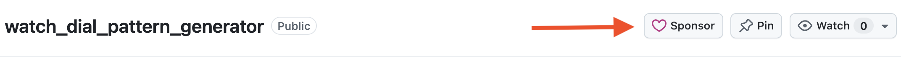

# Watch Dial Pattern Generator

A mathematical grayscale height-map generator for watch dials. Supports a Tkinter desktop GUI and CLI, 24 pattern families, pattern-specific GUI settings, and 8/16-bit PNG plus JSON metadata exports. No artificial lighting is applied to engraving exports.

## Donate/Sponsor

If this app helps with your watchmaking projects, consider supporting its development with a monetary donation. Contributions help fund ongoing development and maintenance. ***Support is entirely optional***—the project remains free and open source. To donate, simply click the **Sponsor** button above and select your preferred payment platform from the list of available options.

<table>
  <tr>
    <td></td>
  </tr>
</table>

## License

Copyright (c) 2026 Bridge Watches LLC. Licensed under the [MIT License](LICENSE).

## Install and run (macOS)

Use Python 3.12 or 3.13 with Tkinter enabled and available VTK wheels. From the project folder:

```bash
python3.12 -m venv .venv
source .venv/bin/activate
python -m pip install -r requirements.txt
python dial_patterns.py
```

If `import tkinter` fails, install a Python distribution with Tcl/Tk support (for example the official python.org macOS installer). CLI mode does not require an active display, though Pillow's ImageTk import still requires Tkinter to be installed.

After creating the environment, you can also launch directly with
`.venv/bin/python dial_patterns.py`. PyVista uses VTK for the interactive inspection window;
no Qt installation is needed. Inspection opens in its own process so the generator remains
responsive. Closing the generator also closes its inspection windows.

## Install and run (Windows)

Install **64-bit Python 3.12 or 3.13** from [python.org](https://www.python.org/downloads/windows/),
including Tcl/Tk support and the Python launcher (`py`). For installer details, see
[Python's Windows setup guide](https://docs.python.org/3.13/using/windows.html).
Download and extract this project, or clone the repository, then open PowerShell
in the project folder (the folder containing `dial_patterns.py` and `requirements.txt`).

Run these commands to create an isolated environment, install dependencies, and
start the desktop GUI:

```powershell
py -3.13 -m venv .venv
.\.venv\Scripts\python.exe -m pip install --upgrade pip
.\.venv\Scripts\python.exe -m pip install -r requirements.txt
.\.venv\Scripts\python.exe dial_patterns.py
```

If you installed Python 3.12, use `py -3.12` in the first command. If `py` is not
recognized, reopen your terminal after installing Python, or use the full path
to your Python 3.12/3.13 executable to create the environment.

On subsequent runs, open PowerShell in the project folder and run:

```powershell
.\.venv\Scripts\python.exe dial_patterns.py
```

These commands also work in Command Prompt. They invoke the environment's Python
directly, so no activation or PowerShell execution-policy change is required. If
you prefer activation, use `.\.venv\Scripts\Activate.ps1` in PowerShell or
`.venv\Scripts\activate.bat` in Command Prompt, then run `python dial_patterns.py`.
See [Python's virtual environment documentation](https://docs.python.org/3.13/library/venv.html)
for details.

To check Tkinter, run `.\.venv\Scripts\python.exe -m tkinter`; a small test window
should open. If it fails, modify or reinstall Python with Tcl/Tk support enabled
and recreate the environment. PyVista installs VTK for the **Inspect enlarged / 3D**
window through `requirements.txt`; no Qt installation is needed.

For CLI use, replace `python3` in the examples below with
`.\.venv\Scripts\python.exe`. For example:

```powershell
.\.venv\Scripts\python.exe dial_patterns.py --cli --pattern rosette --pitch-mm 0.75 --output rosette.png
```

## CLI

```bash
python3 dial_patterns.py --cli --pattern rosette --pitch-mm 0.75 --grooves 24 --amplitude 0.4 --pixels 2048 --output rosette.png
python3 dial_patterns.py --cli --pattern tapisserie --pitch-mm 0.75 --groove-width-mm 0.30 --bevel-width-mm 0.08 --output tapisserie.png
python3 dial_patterns.py --cli --pattern honeycomb --pitch-mm 0.8 --output honeycomb.png
python3 dial_patterns.py --help
```

To see all available options for the CLI, use the `-h` or `--help` command line parameter.

Available patterns: `hobnail`, `barleycorn`, `sunburst`, `basketweave`, `tapisserie`, `fishscales`, `flinque`, `wave`, `annularwave`, `graindorge`, `flamme`, `panier`, `escargot`, `moire`, `chevron`, `rosette`, `sectorrings`, `honeycomb`, `perlage`, `diamondlattice`, `isometriccubes`, `fanscallop`, `asanoha`, and `brick`.

The GUI shows only fields relevant to the chosen pattern and includes a scrollable settings area.

The GUI remembers edited pitch values per pattern until **Reset to defaults**.

The grayscale preview refreshes when you edit a parameter and move focus to another
field. Pattern, style, and checkbox changes refresh immediately. Invalid entries
keep the last valid preview visible and show an error in the status text.

## Interpretation and limitations

- **White = highest surface; black = deepest recess.** Exported 16-bit PNG contains uint16 grayscale values. The 8-bit PNG is for easier software compatibility.
- Target depth is **metadata**, not calibrated material removal. Test and calibrate laser settings before engraving a dial.
- Newly added patterns are **mathematical, stylized interpretations**, not exact reconstructions of historical engine-turning tooling or authenticated artisanal patterns.
- The application exports **raster height maps, not CNC G-code**.
- GUI display has not been visually validated on macOS. Automated render and export tests are included.

## Tests

```bash
python3 -m tests.test_patterns
```

This tests all 24 generators and PNG exports and creates `pattern_catalog.png`.

## Full test suite (including real Tkinter GUI interaction)

The test runner exercises all 24 mathematical pattern renderers and GUI workflows.
It opens a real Tk window, selects every pattern, verifies visible parameter controls,
updates a preview, invokes the GUI export button, and verifies 8/16-bit PNG and JSON output.
Native save dialogs and message boxes are mocked to make tests deterministic.

On macOS with an active desktop session:

```bash
python3 -m tests.run_tests
```

On headless Linux (requires Xvfb):

```bash
xvfb-run -a python3 -m tests.run_tests
```

The GUI test requires a working Tkinter installation and graphical display (or Xvfb).
It is not a native macOS UI rendering test.

## LightBurn 2.1 / 100 W JPT MOPA / F190 lens workflow

LightBurn 2.1 supports 16-bit depth maps in **3D Sliced** image mode for Galvo devices. Import the primary 16-bit PNG, set its physical width to the exported `size_mm`, and use 3D Sliced for layered relief. The `_8bit.png` file is a compatibility copy; the shaded inspection image is not an engraving input.

White is the highest surface and black is the deepest recess. `depth_mm` describes the intended relief span and scales the inspection geometry; it does not set material removal in LightBurn. Pass count, material, focus, speed, power, frequency and pulse width require coupon calibration. A 100 W rating and F190 focal length alone do not establish spot size or achievable detail, so this application does not prescribe laser parameters from those specifications.

At 28.5 mm / 2048 pixels, raster spacing is approximately 13.9 µm. The default 100 µm Perlage ring spacing has about 7.2 pixels per cycle; enlarge ring spacing or increase output resolution when inspecting fine graining. Raster spacing is not the laser spot size or LightBurn scan interval. Inspect minimum feature sizes against measured engraving trials.

Circular mode fills exterior pixels with the selected grayscale level; it does not produce an exclusion mask. Use an appropriate boundary/crop in the engraving workflow, especially because the default black exterior denotes the deepest level.

References: [LightBurn 2.1 Galvo cut settings](https://docs.lightburnsoftware.com/2.1/Reference/CutSettingsEditor/GalvoSpecificCutSettings/) and [3D Sliced engraving guide](https://docs.lightburnsoftware.com/2.1/Guides/3DSlicedImage/).

## v0.2 — Relief geometry and enlarged inspection

- Basketweave and Panier ribbons now descend continuously to common recessed cell boundaries, replacing height jumps at crossovers. This deliberately changes their appearance.
- Fish Scales uses cells bounded by consecutive staggered arcs rather than resetting at horizontal rows. All three styles share recessed arc boundaries. Fan/Scallop uses the same continuous cell layout with internal radial ribs.
- Honeycomb now has flat hexagonal plateaus, recessed joints and linear bevels. Joint width is 5% of pitch; bevel width on each side is `(0.10 + 0.30 * softness) * pitch`. It replaces the old circular mounds.
- Perlage now approximates overlapping shallow circular grain strokes with feathered rims. Ring spacing (`--perlage-ring-pitch-mm`, default 0.1 mm) and overlap (`--perlage-overlap`, default 0.5, range 0–0.5) are independent controls. It is a stylized relief approximation of graining, not a simulation of abrasive tooling. Heights remain within 0.78–1, so relief uses at most 22% of the target depth range; output is intentionally not contrast-normalized.
- **Inspect enlarged / 3D** opens an interactive PyVista window linked to the current full output-resolution map. Drag to orbit/tilt, Shift-drag to pan, and use the wheel to zoom (right-drag also zooms). Crop controls update on release; depth exaggeration updates continuously. Camera position is preserved when changing crop, detail, coloring, or exaggeration. At 1× exaggeration, X/Y and design Z share millimeter units. Crop centers clamp at image edges. Open viewers update automatically about 350 ms after you pause editing a pattern parameter, including pattern selection, inversion, circular masking, size, resolution, and target depth. Full-resolution rendering runs in the background; large maps can take longer. Incomplete or invalid entries retain the last valid surface and show a status message in the generator. Older render results are discarded when newer edits arrive. Rotation, pan, zoom, projection, coloring, mesh detail, and depth exaggeration are preserved; crop controls clamp to the new dial size when needed.
- Mesh detail offers Fast (201), Balanced (401), and Fine (801) samples per side, capped by the source crop resolution. Samples retain their actual pixel-center positions and depth; no smoothing is applied to the geometry. Use a small crop or press **G** for the full-resolution nearest-neighbor grayscale height map to inspect narrow grooves. Press **G** again to restore the 3D camera.
- Camera shortcuts: **T** top, **F** front, **I** isometric, **R** fit/reset framing, **P** perspective/orthographic. **C** toggles depth coloring. **S** opens a save dialog for a labeled inspection screenshot. These screenshots never change the 16-bit engraving PNG. Regenerate older exported maps to adopt the corrected geometry.

## v0.1.5 — Brick and Reset

The Brick / Running Bond pattern uses exact millimeter-defined repeating rectangular
geometry, with alternating staggered courses. Available styles: engraved (flat
brick interiors with recessed joints), faceted (flat plateaus and linear bevels),
and rounded (smooth pillow relief). The Brick-specific GUI fields are shown only
when Brick is selected.

The **Reset to defaults** button restores the startup pattern, every entry and
selection (including hidden pattern-specific values), the invert/circular checkboxes,
and the preview. It does not delete exported files.

Example CLI:

```bash
python3 dial_patterns.py --cli --pattern brick --brick-width-mm 1.2 \
  --brick-height-mm 0.6 --brick-joint-mm 0.1 --brick-bevel-mm 0.08 \
  --brick-row-offset 0.5 --brick-style faceted --depth-mm 0.15 \
  --output brick_faceted.png
```

Use `python3 -m tests.run_tests` to run the expanded regression and GUI test suite.
Grayscale denotes relative height, not a calibrated laser-removal depth.

## v0.1.4 — Fish Scales relief update

- Replaced the old arc-ridge Fish Scales generator with true relief geometry.
- Added three selectable Fish Scales styles: engraved, faceted, and rounded.
- Added GUI/CLI support and regression tests for the new Fish Scales relief styles.

## v0.1.3 — Asanoha multiple relief styles

- Added three selectable Asanoha styles: engraved, faceted, and rounded.
- Added GUI and CLI support for choosing the Asanoha style.
- Added regression tests verifying the styles remain distinct and that relief styles produce meaningful mid-tone depth variation.

## v0.1.2 — Asanoha relief update

- Changed Asanoha from a line-engraving-like pattern to a true faceted relief height map with sculpted surfaces between the grooves.
- Retained controllable line width while adding meaningful Z variation across the non-groove cells.
- Added regression tests to confirm the relief contains substantial mid-tone height variation beyond the groove network.

## v0.1.1 — corrected geometric families

- **Asanoha:** constructed from repeated hexagonal hemp-leaf line segments, including six radial arms, diagonal leaf ribs and perimeter connections. The `--line-width-mm` argument controls actual recessed stroke width.
- **Isometric Cubes:** three rhombus faces tessellate a hexagonal cell. They occupy three distinct height terraces (no directional lighting). `--cube-gap-mm` controls recessed boundaries; `--cube-step-fraction` controls physical relative-height differences.
- Both share a regular triangular tiling only; they no longer share the same synthetic wave-form algorithm.
- New tests: `tests/test_distinct_lattices.py` plus additional GUI field visibility checks.

Examples:

```sh
python3 dial_patterns.py --cli --pattern asanoha --pitch-mm .8 --line-width-mm .055 --output asanoha.png
python3 dial_patterns.py --cli --pattern isometriccubes --pitch-mm .8 --cube-gap-mm .04 --cube-step-fraction .28 --output cubes.png
```

Note: The stepped cube surfaces are actual height terraces; the resulting physical relief will not appear identical to a conventionally shaded 3D cube graphic under all viewing conditions.

## v0.1: refined pattern geometry

The v0.1 release retains all 24 patterns and adds pattern-specific parameters:

- **Hobnail:** `--top-width-mm` makes a mathematically flat truncated-pyramid apex (0 = pointed).
- **Wave:** `--wave-meander-mm` controls lateral waviness independently from `--ridge-height-fraction` (0 = flat, 1 = full grayscale range).
- **Annular Wave:** `--ridge-height-fraction` adjusts concentric ridge height.
- **Grain d'Orge:** `--grain-aspect` adjusts grain elongation; `--amplitude` controls centerline curvature.
- **Flamme:** `--flame-taper` progressively narrows flame ridges outward.
- **Panier:** `--ribbon-curvature` independently controls woven ribbon bowing.
- **Rosette:** `--rosette-harmonics` mixes the primary petal frequency with its second harmonic.

All seven controls appear only when their pattern is selected in the GUI, are available from CLI, and are stored in the JSON metadata. These are mathematical stylizations, not guaranteed reproductions of historical engine-turning cutter trajectories. `depth_mm` remains target-depth metadata rather than a laser or CNC calibration.

Example:

```bash
python3 dial_patterns.py --cli --pattern hobnail --pitch-mm 0.75 --top-width-mm 0.18 --output truncated_hobnail.png
python3 dial_patterns.py --cli --pattern wave --pitch-mm 0.75 --wave-meander-mm 0.22 --ridge-height-fraction 0.6 --output wave.png
```

Run the expanded suite (including GUI interaction tests): `python3 -m tests.run_tests` (on headless Linux: `xvfb-run -a python3 -m tests.run_tests`).
